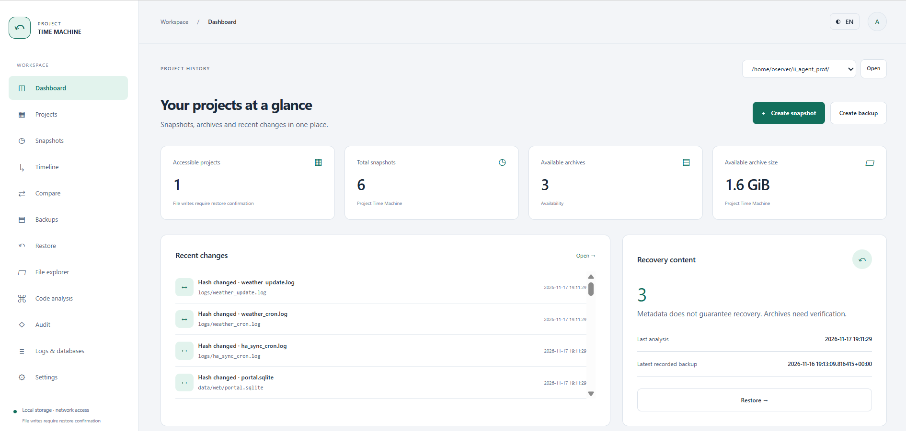
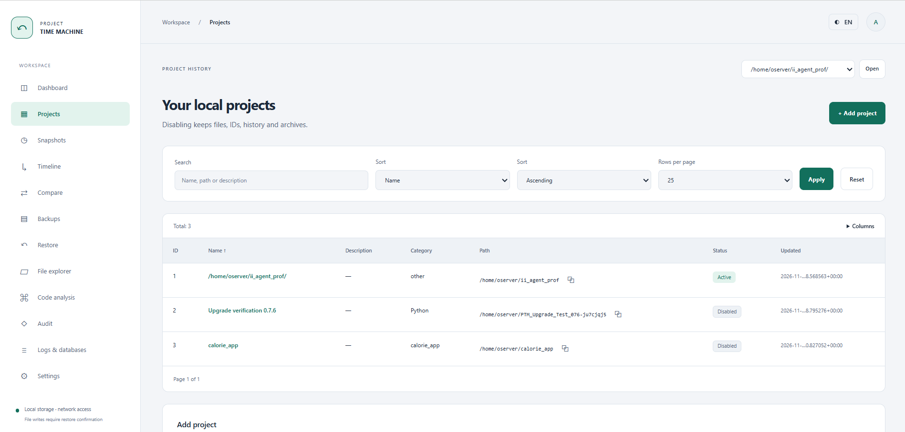
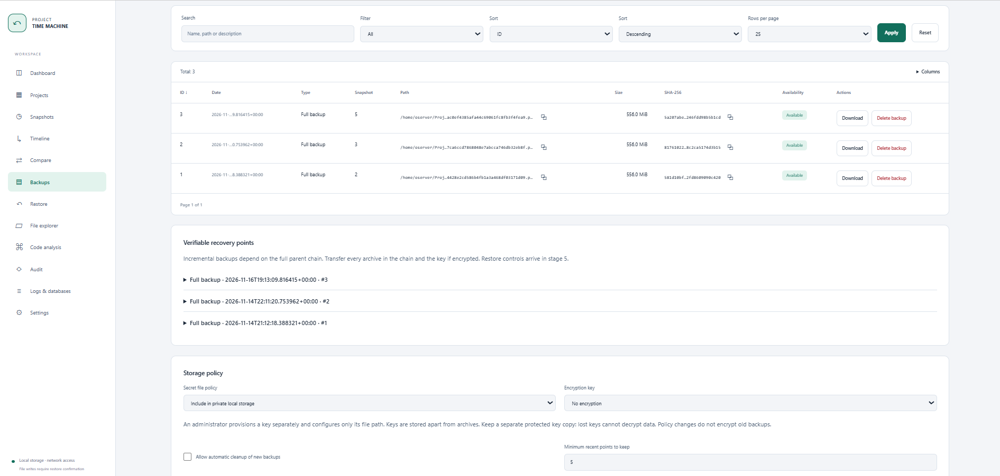
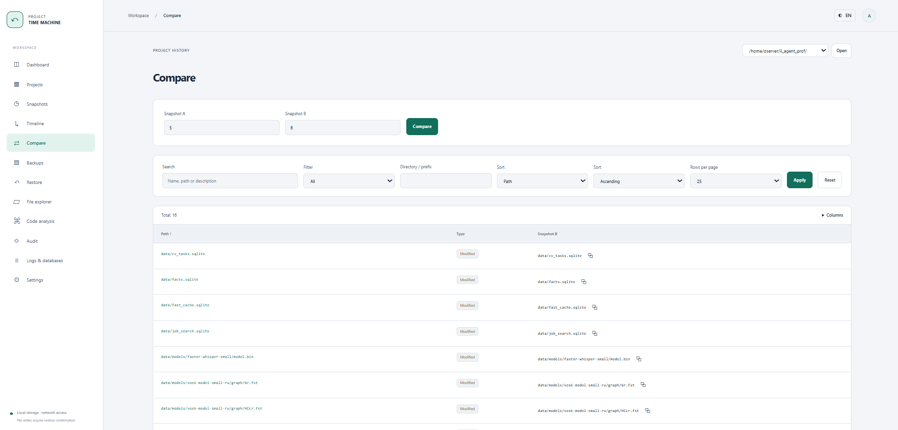

# Project Time Machine 0.7.7

[Русский](README_RU.md) · [Polski](README_PL.md) · [Українська](README_UK.md)

Local project history, verified backups and confirmed recovery through a web interface.
FastAPI, Jinja2 and SQLite; Linux with Python 3.11–3.13. The interface supports English,
Russian, Polish and Ukrainian. Native Windows binaries are not provided; WSL2 is the
Linux-based Windows route. Docker configuration is included.

## Install and use

Download the Linux installer from [GitHub Releases](https://github.com/Oleksandr50/Project-Time-Machine/releases).
Verify its checksum, extract it and open the extracted directory:

```sh
sha256sum --ignore-missing -c SHA256SUMS
tar -xzf project-time-machine-0.7.7-linux.tar.gz
cd project-time-machine-0.7.7
```

From the extracted installer or a cloned source checkout, run as your normal Linux user:

```sh
./install.sh
```

Default installation: `$HOME/ProjectTimeMachine`. Choose another directory or port:

```sh
./install.sh --prefix "$HOME/MyPTM" --port 13021
"$HOME/MyPTM/bin/setup"
```

The installer prints the server interface URLs. Default bind is `0.0.0.0`; use an actual
server address in your browser. Network administrator setup requires the one-time owner
code from `"$HOME/ProjectTimeMachine/bin/ptm" setup-code`. Existing administrators use
their current credentials. Use VPN or HTTPS for remote access over untrusted networks.

Add a project under an allowed directory, create a Full backup, then use Incremental or
Checkpoint before changes. Compare versions and use Restore preview before confirming
file or project recovery. Try recovery on a disposable project first. Custom virtual
environments and generated runtime files need explicit exclusions. User databases are
not automatically excluded. See [English installation](INSTALL_EN.md),
[Russian](INSTALL.md), [Polish](INSTALL_PL.md), [Ukrainian](INSTALL_UK.md).

## Features and limits

- Multiple projects, stable history, Administrator/Operator/Viewer and project permissions.
- Metadata-only and recoverable snapshots, file history, text differences and SHA-256.
- Full, Incremental and Checkpoint backups, chain verification, schedules and protected copies.
- SQLite Backup API capture, optional AES-GCM with external keys, shared exclusion rules.
- Confirmed restore with preview, verified pre-restore insurance, staging and recovery journal.
- Python AST analysis, heuristic security audit, masked reports, bounded logs and SQLite viewing.
- Compact dashboard activity and backup task history with internal scrolling, plus a scrollable archive table with sticky headers.
- Administrator-confirmed removal of disabled projects and individual archives, with dependency checks, cleanup journals and an audit trail.

Removing a project from PTM does **not** delete its source directory or source files.
Archives required by dependent incremental backups or retained restore references cannot
be deleted individually. Protected backups and active operations also block deletion.

Ordinary files changing during capture can prevent publication of a backup. SQLite
consistency is per database, not a transaction across multiple services. Whole-project
atomic overwrite is not guaranteed; stop project writes before restore. Metadata-only
snapshots cannot restore missing contents. Secret masking does not recognize every secret.

## Screenshots

Real application screenshots supplied by the owner. Project names and paths are
shown with the owner's permission.

### Overview



### Projects



### Backups



### Compare



A Code Analysis screenshot will be added when supplied. See the
[screenshot guide](docs/screenshots/README.md).

## Documentation

[User guide](docs/user-guide.md) · [Installation](docs/installation.md) ·
[Updates](docs/updates.md) · [Backup guide](docs/backups.md) ·
[Restore guide](docs/restore.md) · [Authentication](docs/authentication.md) ·
[Analysis and audit](docs/analysis-audit.md) · [Uninstall](docs/uninstall.md).

Interface languages: **English, Russian, Polish and Ukrainian**. Installation guides
and translated READMEs are linked above.

## Author and license

Author: **Oleksandr**  
Copyright: **© 2026 Oleksandr**  
Public contact and commercial permissions: **omtimemachineom@gmail.com**

**Free for non-commercial use. Commercial use requires prior written permission.**

Project Time Machine uses the [Project Time Machine Non-Commercial License 1.0](LICENSE),
a Source-Available Non-Commercial license. Personal, educational, research and other
non-commercial use, study, modification and redistribution are allowed subject to the
license. Commercial internal business use, sale, commercial redistribution and inclusion
in commercial products or paid services require prior written permission.
Modified distributions must preserve attribution and identify material changes and authors.

Third-party components retain their own licenses and copyrights; Oleksandr is not their
author. See [AUTHORS](AUTHORS), [COPYRIGHT](COPYRIGHT),
[THIRD_PARTY_NOTICES.md](THIRD_PARTY_NOTICES.md) and the unmodified notices in `third_party/`.

## Development and security

[Contributing](CONTRIBUTING.md) · [Security reporting](SECURITY.md) ·
[Changelog](CHANGELOG.md) · [Architecture](docs/architecture.md).
Public tests use synthetic fixtures. No user databases, runtime state, binary dependencies
or private development history are included. See [preparation checks](docs/publication-checks.md).
